<!-- Banner: neon red fading to black, matching the avatar -->

<!-- Animated typing header (self-hosted, no external service) -->

 

## 👋 About Me

I’m a software developer from Ghana who enjoys building useful, scalable applications across web, mobile and backend systems. I like understanding how the pieces of a system fit together, and shipping solutions that solve real problems.

- 🚀 Co-founder at **SL**, building technology-driven products
- 🎓 Computer Science student at **KNUST**
- 🤝 Mentor in the Computer Science Department
- 🌱 Currently sharpening how I build reliable, maintainable software

Me, most days. ☕ + 🖤 + code

## 🛠️ Featured Projects

<table>
<tr>
<td width="50%" valign="top">

### 🤟 Tellosign
A computer vision project that recognises sign language, aimed at making communication more accessible.

`Python` `Computer Vision`

[View repository →](https://github.com/chris008123/TELLOSIGN)

</td>
<td width="50%" valign="top">

### ⛪ Partner Up
A mobile app that helps individuals track their church partnership and giving records.

`Mobile` `UI/UX`

[See more →](https://chrisaidoo.vercel.app)

</td>
</tr>
</table>

## 🧰 Tech Stack

**Languages**

**Frontend & Mobile**

**Backend & Databases**

**Tools & Platforms**

## 🐍 Contribution Snake

<picture>
  <source media="(prefers-color-scheme: dark)" srcset="https://raw.githubusercontent.com/chris008123/chris008123/output/github-snake-dark.svg" />
  <source media="(prefers-color-scheme: light)" srcset="https://raw.githubusercontent.com/chris008123/chris008123/output/github-snake.svg" />
  
</picture>

**Always learning. Always building.** 🇬🇭

<a href="https://chrisaidoo.vercel.app">Portfolio</a> · <a href="https://github.com/chris008123">GitHub</a>

